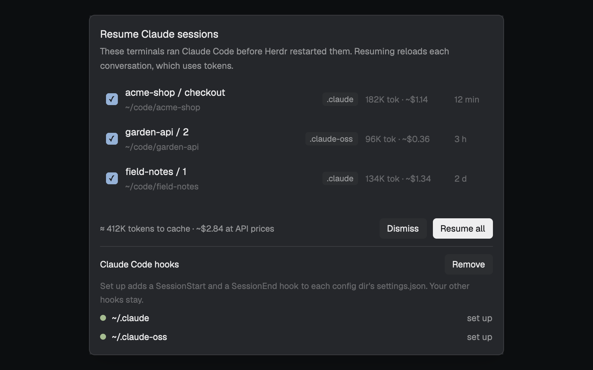
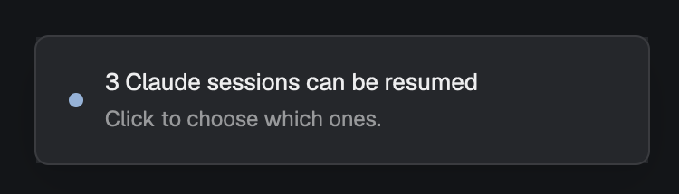
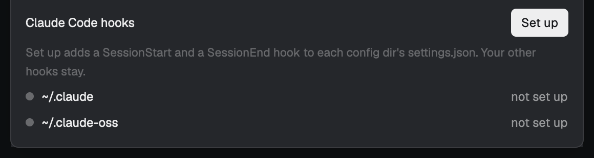

# Corgi · Resume for Herdr

<h3 align="center">Your Claude Code sessions, back after a reboot. Herdr brings your terminals back; this mod brings back the conversations that ran in them, one click each.</h3>

<p align="center"></p>

<p align="center"><sub>✓&nbsp;Free,&nbsp;MIT &nbsp;·&nbsp; ✓&nbsp;Runs&nbsp;locally &nbsp;·&nbsp; ✓&nbsp;herdr-app&nbsp;0.1.14+</sub></p>

Part of [Corgi](https://github.com/saefty/herdr-corgi), a set of Herdr mods that plug into each other.

After a reboot, a logout or a crash of herdr-core, Herdr restores every terminal as a plain shell in its last
folder, under the same address. It never runs the original program again, so the Claude Code sessions are gone
from the screen. This mod remembers which session ran in which terminal. When terminals come back without Claude,
it shows one notification: "3 Claude sessions can be resumed". Click it, pick the sessions, press Resume.

<p align="center"></p>

Nothing resumes by itself. Resuming reloads a whole conversation, which costs tokens, so you choose each one; the
dialog shows roughly how many and what that would cost at API prices.

## Use cases

- **Monday morning after an OS update.** Five terminals had Claude working in them. One click brings back the
  three you still need; Dismiss forgets the rest.
- **herdr-core crashed.** Same thing: the terminals are back as shells, and the notification offers the sessions.
- **Several Claude config dirs.** Sessions started with `CLAUDE_CONFIG_DIR` are resumed with the same config dir,
  so each comes back with the settings and login it ran with.

## How it works

1. A small Claude Code hook (`hook.py`, Python standard library) runs on every SessionStart and SessionEnd. Inside a
   Herdr terminal (`HC_TERMINAL_ID` is set) it writes `~/.config/herdr-app/data/resume/<terminal>.json`: the session
   id, its folder and its config dir. `/clear` overwrites it; leaving Claude yourself (`/exit`, Ctrl+C, Ctrl+D)
   deletes it. When Claude is killed instead (shutdown, logout, OS update, a crash) the record stays: that is the
   session to offer afterwards.
2. The mod watches Herdr's terminals. A record whose terminal is live but no longer runs Claude can be resumed.
3. The dialog lists them with their space and tab, folder, config dir, last activity, and what resuming costs: the
   cache expired with the reboot, so the first message writes the whole context to the prompt cache again. The
   estimate is the context size of the session's last turn (from the end of its transcript) at Anthropic API list
   prices, e.g. "≈ 412K tokens to cache · ~$2.06 at API prices" in total for the ticked rows. Resume types
   `cd '<folder>'; env CLAUDE_CONFIG_DIR='<dir>' claude --resume <id>` into each chosen terminal (without the `env`
   part for the default `~/.claude`). The quoting works in sh, bash, zsh and fish.

## Requirements

- macOS or Linux, the Herdr app, Claude Code.
- `python3` on your PATH, standard library only.
- `claude` on your PATH as a program (`env` doesn't run shell aliases or functions).

## Install in three steps

<table>
<tr>
<td align="center" valign="top" width="33%"><h3>1</h3><b>Add the mod</b><br /><sub>With <a href="https://github.com/saefty/herdr-corgi">Corgi</a>: <code>corgi enable resume</code>. By hand: copy <code>mods/resume</code> to <code>~/.config/herdr-app/mods/</code>.</sub></td>
<td align="center" valign="top" width="33%"><h3>2</h3><b>Place the watcher</b><br /><sub>One floating entry in your layout. It draws nothing.</sub></td>
<td align="center" valign="top" width="33%"><h3>3</h3><b>Set up the hooks</b><br /><sub>Open the dialog and click Set up. Nothing is written before that click.</sub></td>
</tr>
</table>

Or tell your agent: `Read ~/.config/herdr-app/AGENTS.md, then add this mod: https://github.com/saefty/herdr-corgi-resume/tree/main`

By hand, step by step:

1. Copy `mods/resume` to `~/.config/herdr-app/mods/`.
2. Place the watcher. Herdr's own layouts are read-only, so clone yours first:
   `herdr-app do layout.clone '{"name":"main","as":"my-main"}'`, then add to the root node of
   `~/.config/herdr-app/layouts/my-main.json` (or to its `floating` list if it has one):

   ```json
   "floating": [
     { "id": "resume", "content": { "mod": "resume" }, "edge": "top", "align": "end" }
   ]
   ```

   Add it to every layout you use: the watcher only runs in the shown one.
3. Run `herdr-app check ~/.config/herdr-app/mods/resume`.
4. Open the dialog: `herdr-app do mod.open --name resume` (until a config dir is set up, every start of Herdr also
   posts a notification that opens it). Click **Set up**. Without the hooks nothing is recorded, so nothing can be
   offered after a restart. With Corgi installed, its popup has a row "Resume Claude sessions" that opens the same
   dialog and says whether the hooks are set up.

<p align="center"></p>

Set up adds one SessionStart and one SessionEnd entry, `python3 ~/.config/herdr-app/mods/resume/hook.py`, to the
`settings.json` of `~/.claude` and of every `~/.claude-*` folder that has a `settings.json` or a `projects/` folder.
Your other hooks and settings stay as they are; the first change keeps a copy as `settings.json.resume.bak`.
**Remove** takes out exactly those entries. Sessions already running are recorded from their next start or
`/clear`.

The mod runs `python3 hook.py` from its folder and `hc ls` / `hc send`. It reads and writes
`~/.config/herdr-app/data/resume/` and, on Set up or Remove only, the `settings.json` files above. No network.

## Customize

- **Where the watcher sits:** any edge; it is never visible.
- **Other config dirs:** the hook records whatever `CLAUDE_CONFIG_DIR` a session runs with, wherever it is. Set up
  only finds `~/.claude` and `~/.claude-*`; for a dir elsewhere, add the same two hook entries by hand.

Changed the code itself? Your edits survive `corgi update`: Corgi merges your version, the old release and the new
one.

## Tests

`python3 mods/resume/test_hook.py`

## Demo

The screenshots show invented sessions (`demo/`), not real ones. `sh demo/setup.sh` builds a separate Herdr home in
`demo/home` with three sessions from `demo/fixtures/sessions.json` and an invented user home with `~/.claude` and
`~/.claude-oss` (`--no-hooks` leaves them not set up). Open a second Herdr window on it with the
`HERDR_APP_HOME` and `RESUME_FIXTURE` the script prints, switch it to the `demo` layout
(`herdr-app do layout.switch --name demo`) for the notification, and `herdr-app do mod.open --name resume` for the
dialog. `RESUME_FIXTURE` stands in for `hc ls` and your home folder, so your real terminals and config dirs don't
show; Resume does nothing useful there.

## License

MIT
