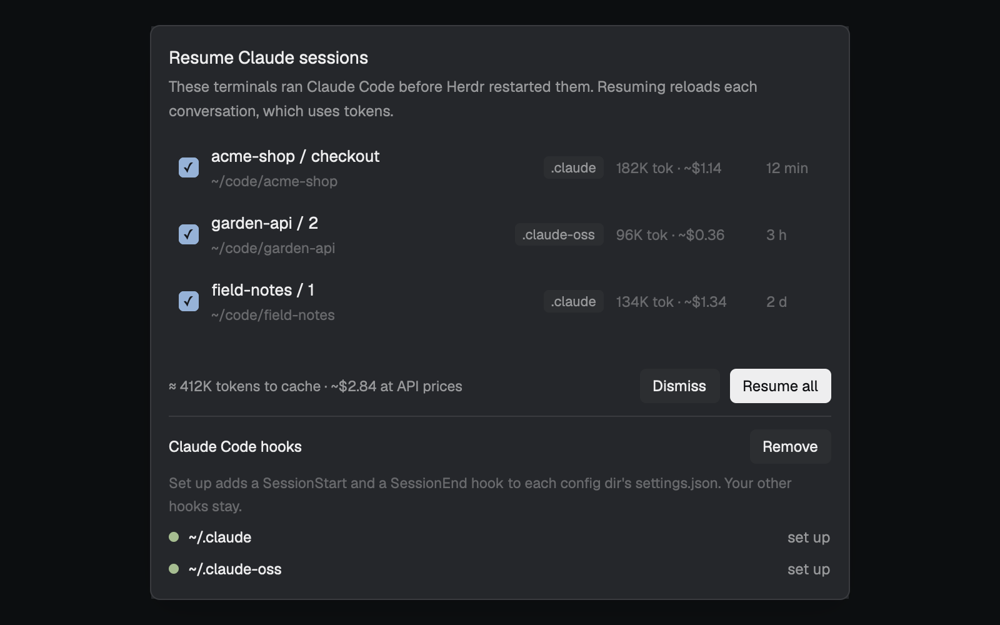

# Corgi · Resume

After a reboot, Herdr's terminals come back as plain shells and the Claude Code sessions in them are gone. This mod
remembers which session ran in which terminal, posts one notification when some can be resumed, and opens a dialog
where the person picks the ones to bring back. Nothing resumes without a click.

<!-- TODO:  -->

**What you see:**
- Nothing while there is nothing to resume: the watcher is a floating block that renders an empty `div`, so Herdr
  hides it.
- A notification, level `info`: title "N Claude sessions can be resumed" ("1 Claude session" for one), body "Click
  to choose which ones.". Clicking it runs `mod.open {name: "resume"}`.
- Once ever, when no Claude config dir has the hooks yet: "Resume Claude sessions after a restart", body "Click to
  set up the Claude Code hooks it needs.", same action.
- The dialog (`mod.json` overlay: `dialog`, 560 × 460), `popover` background, 14 px padding, 10 px gaps:
  - Title "Resume Claude sessions", 14 px semibold; under it in 12 px `muted`: "These terminals ran Claude Code before
    Herdr restarted them. Resuming reloads each conversation, which uses tokens."
  - A scrolling list, one row per session (8 px × 6 px padding, 5 px corners, `hover` background): a 16 px checkbox
    (4 px corners; checked: `accent` fill and border with a "✓" in `accent_foreground`; unchecked: `background` fill,
    `input` border), then the terminal's place (`hc ls` `where`, e.g. "repo / 2", 13 px `foreground`) above its
    folder (`~`-shortened, 11.5 px `dim`), a chip with the config dir's basename (".claude", ".claude-work"; 11 px
    `muted` on `raised`), the cache estimate ("412K tok · ~$2.06", 11.5 px `dim`, 110 px wide, empty without one;
    tooltip: model, cache TTL and why resuming writes the cache), and the age of the last activity ("now", "12 min", "3 h", "2 d"; 11.5 px `dim`, 44 px
    wide). All rows start checked. Empty: "Nothing to resume. A session shows up here when its terminal is back as a
    plain shell." While loading: "Looking...".
  - An error line in `blocked`, 11.5 px, when something failed.
  - Left of the buttons, 11.5 px `muted`, the total over the checked rows: "≈ 412K tokens to cache · ~$2.06 at API
    prices" ("+" after the dollars when a row's model has no known price; no dollar part when none has). Tooltip:
    the cache expired, the first message after resuming writes the whole context to the cache once, later turns
    read it at a tenth of the price; API list prices, a subscription isn't billed per token.
  - Right-aligned buttons (12 px, 10 × 4 px padding, 5 px corners): "Dismiss" (`raised`) and "Resume all" or
    "Resume N" when some are unchecked (`solid` / `solid_foreground`, `accent` on hover; dimmed to 0.45 and inert
    with none checked or while busy).
  - Below a `border` line: "Claude Code hooks" (12 px semibold) with "Remove" (when any dir is set up) and "Set up"
    (primary, when any dir is not), a 11.5 px `dim` note ("Set up adds a SessionStart and a SessionEnd hook to each
    config dir's settings.json. Your other hooks stay."), and one line per config dir: an 8 px dot (`ansi2` set up,
    `dim` not), the `~`-shortened path, and "set up" / "not set up" in `muted`, or that dir's error in `blocked`.

**How it behaves:**
- Agent statuses don't matter. A record is offered when its terminal is in `hc ls`, `state` is `live`, and `agent`
  is neither `claude-code` nor `claude`; and its transcript file exists (a session that never got a message can't be
  resumed).
- The watcher reruns the check when it starts and whenever `terminals()` changes (address, agent or state; the check
  runs from `render`, not a timer). It notifies only when the set holds a session the last notification didn't
  (`resume.notified`, a sorted `terminal:session` list in shared state), so resuming some never re-notifies.
- A row click toggles its checkbox. Resume runs `hc send <terminal> "<command>"` for each checked row (`hc send`
  pastes and presses Enter), then closes the dialog. The command:
  `cd '<cwd>'; env CLAUDE_CONFIG_DIR='<dir>' claude --resume '<id>'`, without the `env` part when the session ran
  with the default config dir. The resumed Claude's own SessionStart then rewrites the record.
- Dismiss deletes the records of every listed row and closes the dialog.
- Set up / Remove run `hook.py setup` / `hook.py remove` and redraw the dir list from the answer.
- Esc closes the dialog.

**Built from:**
- `mods/resume/mod.json`: `{ "place": "none", "title": "Resume Claude sessions", "overlay": { "kind": "dialog",
  "width": 560, "height": 460 } }`. The watcher is placed by each layout's `floating` list:
  `{ "id": "resume", "content": { "mod": "resume" }, "edge": "top", "align": "end" }`.
- `main.js`: one View, two roles by `props().overlay` (none: watcher; set: dialog). Uses `exec`, `hc`, `appHome`,
  `home`, `notify`, `props`, `closeOverlay`, `shared`, `setShared`, `terminals`, `theme`, and the command `mod.open`.
- `hook.py` (python3, standard library), run as `python3 <app home>/mods/resume/hook.py <command>`, each printing
  one JSON object:
  - no arguments: the Claude Code hook. Reads the hook JSON (`hook_event_name`, `session_id`, `cwd`,
    `transcript_path`) from stdin. SessionStart with `HC_TERMINAL_ID` set writes
    `<app home>/data/resume/<HC_TERMINAL_ID>.json` = `{terminal, session_id, cwd, config_dir, transcript, at}`
    atomically (`config_dir`: `CLAUDE_CONFIG_DIR` made absolute, or null); SessionEnd deletes it only when its
    `session_id` matches. Never prints, always exits 0. `<app home>` is `HERDR_APP_HOME`, else `~/.config/herdr-app`.
  - `status`: `{dirs: [{dir, label, installed}]}` for `~/.claude` plus each `~/.claude-*` dir holding a
    `settings.json` or `projects/`.
  - `setup` / `remove`: the same, after merging. Setup appends `{"hooks": [{"type": "command", "command":
    "python3 <abs path of hook.py>"}]}` (no matcher) to `hooks.SessionStart` and `hooks.SessionEnd` unless that
    command is already there; remove takes that command out and drops a group, event or `hooks` key only when it
    became empty. Atomic write, `settings.json.resume.bak` once, a dir whose file isn't a JSON object gets `error`
    and is left alone.
  - `candidates`: `{candidates: [{...record, command, where, label, last}], core}`; runs `hc ls --json`. With
    `--cost` (the dialog, not the watcher) each row also gets `cache`: `{tokens, model, ttl, cost}` or null. It reads
    the transcript backwards in 64 KB chunks (they reach 50+ MB) to the last `type: "assistant"` line with a
    `message.usage` (skipping `isSidechain` and the `<synthetic>` model): tokens = `input_tokens` +
    `cache_read_input_tokens` + `cache_creation_input_tokens`; ttl `1h` when
    `usage.cache_creation.ephemeral_1h_input_tokens` > 0, else `5m`; cost = tokens × input list price × 1.25 (5m) or
    × 2 (1h), the price by the longest matching model-id prefix (`PRICES` in hook.py; date suffix or `[1m]` allowed),
    null for an unknown model.
  - `dismiss <terminal>...`: deletes those records.
- `test_hook.py`: `python3 test_hook.py`, in a temp `HOME` and `HERDR_APP_HOME`.

**Watch out:**
- A SessionStart hook's plain stdout becomes context for Claude: the hook must print nothing.
- `claude -p` and SDK apps started inside a Herdr terminal (from Claude's own shell, a script) inherit
  `HC_TERMINAL_ID` and fire the same hooks. Only `CLAUDE_CODE_ENTRYPOINT=cli` (the interactive session) is recorded;
  `-p` runs report `sdk-cli`.
- `/clear` and `/resume` fire SessionEnd (old id) and SessionStart (new id). Deleting only on a matching id keeps the
  record right in either order.
- Quoting must work in sh, bash, zsh and fish: fish reads `\'` and `\\` as escapes even inside single quotes, so put
  `'` and `\` outside the quotes (`'\''`, `'\\'`). Refuse control characters: `hc send` presses Enter.
- `env` runs `claude` from PATH: an alias or shell function named `claude` isn't used.
- A record whose terminal is missing from a non-empty `hc ls` is deleted, so a later terminal with the same address
  isn't offered someone else's session. When `hc ls` fails or lists nothing, nothing is deleted.
- `herdr-app check` only renders the watcher (no overlay props); check the dialog by hand.
- Local terminals only: a session on another machine writes its record on that machine.
- The cost is an estimate at API list prices: Claude Code may trim or reshape the context on resume, and a
  subscription isn't billed per token. Update `PRICES` when Anthropic's prices change.
- Settings writes reformat `settings.json` (2-space JSON); content and key order stay.

**Done when:** `herdr-app check mods/resume` passes; `python3 mods/resume/test_hook.py` prints "all passed" (it runs
the resume command through sh, bash, zsh and fish with a folder named `it's a dir \ with $HOME`); after Set up,
`claude` in a Herdr terminal writes `data/resume/<terminal>.json` and `/exit` deletes it; with a record whose
terminal now runs a plain shell, the notification appears once and Resume types the command into that terminal.
